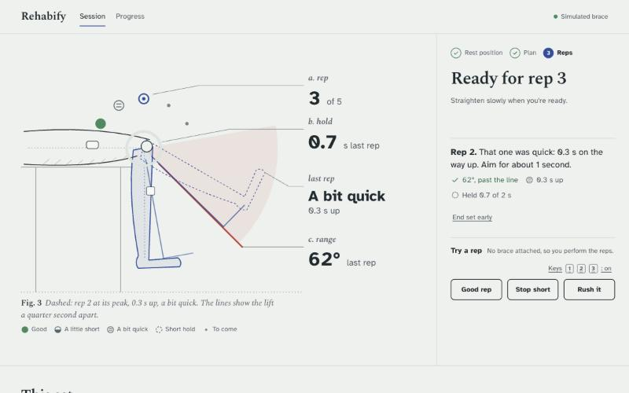

# Rehabify

Rehabify turns an ordinary knee brace into a rehabilitation assistant. It doesn't just count your reps: it checks each one for **range, pace and hold**, clicks through the brace when you reach your physio's target, and shows your progress between appointments.



## Try it in one minute (no hardware)

You only need Python 3. There's nothing to install.

```bash
python3 server.py --sim
```

Open http://localhost:8000, then:

1. **Set rest position.** The simulated leg is already sitting still.
2. **Start set.** The plan is straighten to 50°, hold 2 seconds, 5 times.
3. Press **Good rep**, then **Stop short**, then **Rush it** (or keys 1, 2, 3). Watch the leg, the hold ring and the coaching change for each one.
4. Finish the set to see your summary, then scroll to **Your progress**. The earlier hollow points are sample sets, shown only in simulator mode.

## How it works

One BMI270 motion sensor on the shin, an Arduino R4 WiFi, and a DRV2605L vibration driver. The Arduino streams raw sensor data over USB to a small Python server, on a Raspberry Pi 4B or a laptop. The server estimates shin rotation from gravity and the gyro, grades each rep against the physio's targets, triggers the vibration, and serves the page.

```
BMI270 + DRV2605L --I2C-- Arduino R4 --USB serial-- server.py (Pi/laptop) --SSE--> browser
                                      <-- "B<n>" buzz --         |
                                                         sessions/*.json + *.csv
```

Rehabify reports an *estimated movement range* from the rest position you set, for seated knee extensions with the thigh supported. It doesn't diagnose or replace a physiotherapist. Walking analysis is where we'd like to take it next.

## Run with the brace

With the brace plugged in:

```bash
python3 server.py
```

The server auto-detects the Arduino; to choose the port yourself, pass `--serial /dev/ttyACM0` (Pi) or `--serial /dev/cu.usbmodemXXXX` (Mac).

### On the Raspberry Pi

```bash
sudo apt install python3-serial python3-sklearn   # apt avoids building sklearn with pip on the Pi
sudo usermod -aG dialout $USER                    # serial access; log out and back in
python3 server.py
```

Open `http://<pi-hostname>.local:8000` from any laptop on the same network.

## Arduino

Flash `arduino/rehabify/rehabify.ino`. It needs two libraries from the Library Manager: SparkFun BMI270 and Adafruit DRV2605. Check the wiring note at the top of the file: the BMI270 is a 3.3 V part.

The Serial Monitor at 115200 should show `# ready` and then CSV lines. Close the Serial Monitor before you start the server, because only one program can hold the port.

## Using it

1. **Calibrate:** sit with the thigh supported and the foot relaxed, then hold still for 2 s. This records the rest pose and the gyro offset.
2. **Pick a profile:** set the target range, hold time, minimum extend and return times, and reps, then save it.
3. **Start set:** the brace vibrates when the leg reaches the target (click), when the hold is complete (double click), and when the set is done (buzz). The set saves itself when the last rep finishes.

All angles are an **estimated movement range** measured from the calibrated rest pose. They are not an absolute knee angle. The estimate assumes the thigh stays still.

## Training the classifier

1. Record labelled sets: choose a label under *Training label* and record at least 2 sets of about 5 reps for each of `controlled`, `short`, and `rushed`. More sets make a better test.
2. Train:

   ```bash
   pip install scikit-learn
   python3 train.py
   ```

   The script holds out about 20% of **whole sessions** per label for testing, prints test accuracy, a confusion matrix, and feature importances, then writes `model.pkl`.
3. The next set you start shows an AI label for each rep next to the rule-based result.

## Files

| File | Purpose |
|---|---|
| `core.py` | Tilt filter, rep detection, metrics, and simulator. `python3 core.py` runs the self-check. |
| `server.py` | Serial or sim input, HTTP server, live event stream, session storage |
| `static/index.html` | Dashboard |
| `train.py` | Classifier training with a session-level split |
| `profiles.json` | Exercise profiles |
| `sessions/` | One `.json` (reps and summary) and one `.csv` (raw 100 Hz IMU data plus angle) per set |
| `arduino/rehabify/` | Firmware |

## Tuning knobs

- `TiltFilter.ALPHA` in `core.py` (default 0.98): raise it if the angle is noisy, lower it if it drifts or lags.
- `HAPTIC` in `server.py`: the DRV2605 effect IDs used for each event. Use the **Test vibration** button to try them.
- The calibration counts as still when gyro noise is below 3 °/s (`core.py`).
